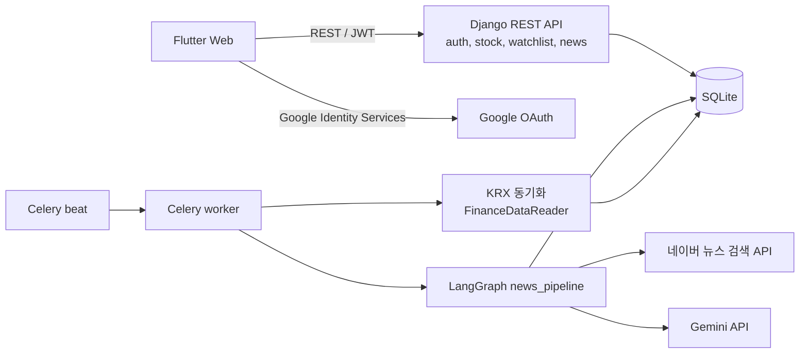

# Trender

Trender는 관심종목의 시세와 관련 뉴스를 한 화면에서 보여주는 주식 뉴스 분석 웹 서비스입니다. 관심종목 뉴스를 주기적으로 수집하고, Gemini로 기사마다 3줄 요약, 호재/악재/중립 판단, 판단 근거, 종목 관련도를 만들어 저장합니다.

## 목차

- [주요 기능](#주요-기능)
- [아키텍처](#아키텍처)
- [기술 스택](#기술-스택)
- [저장소 구조](#저장소-구조)
- [시작하기](#시작하기)
- [스크립트](#스크립트)
- [문서](#문서)
- [현재 제약 사항과 계획](#현재-제약-사항과-계획)

## 주요 기능

| 기능 | 설명 |
|---|---|
| 회원 인증 | 아이디 또는 이메일 로그인, Google 계정 로그인, JWT 발급과 자동 갱신 |
| 종목 검색과 시세 | KRX 상장 종목 검색, 관심종목 시세 조회. 종목 마스터와 시세는 스케줄러가 자동 동기화 |
| 관심종목 관리 | 그룹 생성, 이름 변경, 삭제, 순서 변경. 그룹 간 종목 추가, 이동, 삭제 |
| 뉴스 분석 | 네이버 뉴스 수집, Gemini 분석(3줄 요약, 감성, 판단 근거, 관련도), 종목별 뉴스 피드 |
| 웹 지원 | Flutter Web. 넓은 화면은 좌측 내비게이션, 좁은 화면은 하단 탭바 |

## 아키텍처



- 사용자 요청은 Django REST API가 처리합니다. 인증은 simplejwt 기반 JWT를 사용하며, Google 로그인은 프론트가 받은 ID 토큰을 백엔드가 검증한 뒤 같은 JWT를 발급합니다.
- 주기 작업은 Celery beat가 예약하고 Celery worker가 실행합니다. Redis가 브로커 역할을 합니다.
- 뉴스 수집과 분석은 LangGraph `StateGraph`로 구성한 고정 워크플로우입니다. 키워드별 검색과 기사별 분석을 병렬로 실행하고, DB 저장은 마지막 노드 한 곳에서만 합니다. 자세한 내용은 [뉴스 분석 파이프라인](README/ai.md)을 참고하세요.

## 기술 스택

| 구분 | 사용 기술 |
|---|---|
| 프론트엔드 | Flutter Web 3.47.9 (FVM으로 버전 고정), provider, http, shared_preferences, google_sign_in |
| 백엔드 | Python 3.12, Django 5.2, Django REST Framework, simplejwt, drf-spectacular, django-cors-headers |
| 비동기와 스케줄 | Celery, Redis (Docker Compose) |
| LLM | Gemini (`gemini-3.5-flash-lite`, 변경 가능), LangGraph, langchain-google-genai |
| 데이터 수집 | 네이버 뉴스 검색 API, BeautifulSoup4, FinanceDataReader |
| 데이터베이스 | SQLite (개발용) |

## 저장소 구조

```
stock_agent/
├── backend/              Django API 서버
│   ├── apps/             도메인 앱 (auth, stock, watchlist, news)
│   ├── config/           settings, urls, celery 설정
│   └── core/
│       ├── graph/        LangGraph 뉴스 파이프라인
│       ├── llm/          Gemini 뉴스 분석기, 평가 스크립트
│       └── scrapers/     네이버 뉴스, KRX 수집기
├── frontend/             Flutter Web 앱
├── docs/                 API 명세, 설계 문서
├── README/               실행 가이드 (backend, frontend, 뉴스 분석)
├── scripts/              Windows 실행 스크립트
└── docker-compose.yml    Redis
```

## 시작하기

### 사전 준비

| 항목 | 버전 | 용도 |
|---|---|---|
| Python | 3.12 | 백엔드. `setup.bat`은 기본으로 `C:\development\python\python-3.12.10\python.exe`를 사용 |
| FVM과 Flutter | Flutter 3.47.9 (`frontend/.fvmrc`) | 프론트엔드 |
| Chrome | 최신 | 웹 실행 |
| Docker Desktop | 선택 | Celery용 Redis |

### 1. 최초 셋업

```bat
scripts\setup.bat
```

가상환경 생성, 패키지 설치, `backend/.env` 생성(`DJANGO_SECRET_KEY` 자동 생성), DB 마이그레이션, KRX 종목과 시세 동기화, Flutter 패키지 설치를 순서대로 실행합니다. 다른 Python을 쓰려면 실행 전에 `set PYTHON=<python.exe 경로>`를 지정합니다.

### 2. API 키 설정

`backend/.env`에 필요한 키를 채웁니다. 키가 없어도 서버와 웹은 실행되며, 해당 기능만 비활성화됩니다.

| 변수 | 필요한 기능 |
|---|---|
| `NAVER_CLIENT_ID`, `NAVER_CLIENT_SECRET` | 뉴스 수집 |
| `GEMINI_API_KEY` | 뉴스 분석 |
| `GOOGLE_CLIENT_ID` | Google 로그인 |

전체 환경변수는 [Backend 가이드](README/backend.md#환경변수)를 참고하세요.

### 3. 실행

```bat
scripts\dev.bat
```

| 서비스 | 주소 |
|---|---|
| 웹 | http://localhost:3000 |
| API 문서 (Swagger) | http://localhost:8000/api/docs/ |
| 관리자 페이지 | http://localhost:8000/admin/ |

### 4. 뉴스 수집

뉴스는 관심종목 기준으로 수집합니다. 웹에서 회원가입 후 관심종목을 추가하고 다음을 실행합니다.

```bat
scripts\collect_news.bat --keywords 삼성전자 --per-keyword 3
scripts\collect_news.bat
```

자동 수집을 켜려면 `scripts\dev.bat celery`로 실행합니다.

### 5. 외부 공개 (ngrok)

```bat
scripts\manager.bat
```

메뉴 1번은 Docker, Redis, ngrok, Django, Celery worker와 beat를 순서대로 실행하고 외부 주소를 출력합니다. Django가 빌드된 웹도 함께 서빙하므로 ngrok 주소 하나로 웹과 API를 모두 사용할 수 있습니다. 자세한 내용은 [Backend 가이드](README/backend.md#외부-공개-ngrok)를 참고하세요.

## 스크립트

모든 스크립트는 저장소 루트에서 실행합니다.

| 스크립트 | 설명 |
|---|---|
| `scripts\setup.bat` | 최초 셋업 |
| `scripts\manager.bat` | 외부 공개용 메뉴. 전체 실행, ngrok 주소 확인, 웹 빌드, 키 상태 확인, 마이그레이션, 서비스 종료, 앱 생성 |
| `scripts\dev.bat [celery]` | 백엔드와 웹 실행. `celery` 인자를 주면 Redis, Celery worker, Celery beat도 실행 |
| `scripts\backend.bat` | 백엔드만 실행 (미적용 마이그레이션 자동 적용) |
| `scripts\web.bat` | 웹만 실행 (Chrome, 포트 3000) |
| `scripts\celery.bat worker\|beat` | Celery worker 또는 beat 실행 |
| `scripts\collect_news.bat [옵션]` | 뉴스 수집. 옵션은 `collect_news` 명령에 그대로 전달 |
| `scripts\sync_krx.bat` | KRX 종목 마스터와 시세 동기화 |
| `scripts\migrate.bat` | `makemigrations` 후 `migrate` |
| `scripts\test.bat` | 백엔드 테스트와 `flutter analyze` |
| `scripts\reset_db.bat` | DB 삭제 후 재생성. 확인 입력 필요 |

## 문서

| 문서 | 내용 |
|---|---|
| [Backend 가이드](README/backend.md) | 백엔드 설치, 환경변수, 스케줄, 테스트 |
| [Frontend 가이드](README/frontend.md) | 웹 실행, Google 로그인 설정, 배포 빌드 |
| [뉴스 분석 파이프라인](README/ai.md) | 수집, 분석, 저장 흐름과 운영 설정 |
| [API 명세](docs/api-spec.md) | REST API 엔드포인트와 요청, 응답 형식 |
| [LLM 파이프라인 설계](docs/llm-pipeline.md) | 뉴스 분석 파이프라인 설계, 검토한 대안, 챗봇 에이전트 계획 |
| [뉴스 요약 AI 계약](docs/news-summary-ai-contract.md) | 분석 서비스를 분리할 경우의 입출력 스키마 |

## 현재 제약 사항과 계획

- 데이터베이스는 SQLite입니다. 운영 배포와 임베딩(pgvector) 도입 전에 PostgreSQL로 전환할 예정입니다.
- 뉴스 API의 `ai_reason` 필드는 아직 고정 문장을 반환합니다. 저장된 `StockNews.reason`을 반환하도록 수정할 예정입니다.
- 챗봇 탭은 준비 중입니다. LangGraph 에이전트가 종목 검색, 시세, 관심종목, 뉴스 기능을 도구로 호출하는 형태로 구현할 계획입니다.
- 토큰은 브라우저 localStorage에 저장합니다. 운영 배포 전에 refresh 토큰을 HttpOnly 쿠키로 옮기는 것을 검토합니다.
