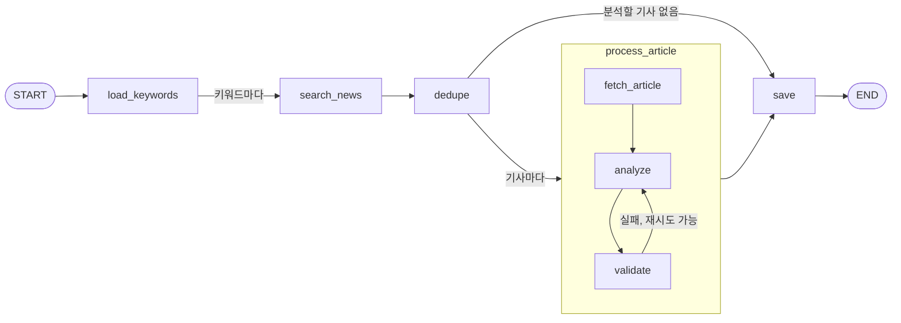

# 뉴스 분석 파이프라인

관심종목 뉴스를 수집하고 Gemini로 분석해 저장하는 과정을 설명합니다. 코드는 `backend/core/`에 있고, 실행은 `collect_news` 관리 명령 또는 Celery 작업으로 합니다.

## 목차

- [개요](#개요)
- [처리 흐름](#처리-흐름)
- [분석 결과](#분석-결과)
- [실행](#실행)
- [동시성과 호출 제한](#동시성과-호출-제한)
- [오류 처리](#오류-처리)
- [분석 품질 평가](#분석-품질-평가)

## 개요

| 구성 요소 | 경로 | 역할 |
|---|---|---|
| 파이프라인 | `core/graph/news_pipeline.py` | LangGraph `StateGraph`. 검색, 중복 제거, 기사별 분석, 저장 순서와 병렬 실행을 담당 |
| 분석기 | `core/llm/news_analyzer.py` | Gemini 구조화 출력 호출과 결과 검증 |
| 수집기 | `core/scrapers/crawler.py` | 네이버 뉴스 검색 API 호출과 기사 본문 추출. DB에 접근하지 않음 |
| 저장 | `apps/trender_news/ingest.py` | 분석 결과를 `News`, `StockNews`에 저장 |
| 진입점 | `apps/trender_news/management/commands/collect_news.py`, `apps/trender_news/tasks.py` | 관리 명령과 Celery 작업 |

## 처리 흐름



| 노드 | 설명 |
|---|---|
| `load_keywords` | 대상 종목명을 정합니다. 기본값은 모든 사용자의 관심종목이며, `--keywords`로 지정할 수 있습니다 |
| `search_news` | 키워드별로 네이버 뉴스를 검색해 후보 기사를 모읍니다. 키워드마다 병렬 실행됩니다 |
| `dedupe` | 종목 마스터에 없는 키워드와, 같은 종목으로 이미 저장된 기사를 제외합니다. Gemini 호출 비용을 줄이는 단계입니다 |
| `process_article` | 기사 1건을 처리하는 하위 그래프입니다. 기사마다 병렬 실행됩니다 |
| `fetch_article` | 네이버 뉴스 본문을 추출합니다. 본문이 50자 미만이면 분석하지 않습니다 |
| `analyze` | Gemini로 기사를 분석합니다. 본문은 최대 8,000자까지 전달합니다 |
| `validate` | 결과를 검증하고 실패하면 한 번 더 분석합니다 (최대 2회) |
| `save` | 분석된 기사를 한 번에 저장하고 통계를 만듭니다. SQLite 쓰기 잠금을 피하기 위해 저장은 이 노드에서만 합니다 |

## 분석 결과

Gemini는 아래 스키마로 응답하도록 구조화 출력을 사용합니다 (`NewsAnalysis`).

| 필드 | 타입 | 저장 위치 |
|---|---|---|
| `summary` | 문자열 3개 | `News.summary` (줄바꿈으로 연결) |
| `sentiment` | `POSITIVE`, `NEGATIVE`, `NEUTRAL` | `StockNews.sentiment` |
| `reason` | 문자열 | `StockNews.reason` |
| `relevance` | 0.0-1.0 | `StockNews.relevance` |

시스템 프롬프트는 기사 본문에 포함된 지시문을 따르지 않도록 지정합니다.

## 실행

먼저 `backend/.env`에 `NAVER_CLIENT_ID`, `NAVER_CLIENT_SECRET`, `GEMINI_API_KEY`를 설정합니다.

```bat
scripts\collect_news.bat --keywords 삼성전자 --per-keyword 3
scripts\collect_news.bat
```

실행이 끝나면 다음과 같은 요약이 출력됩니다.

```
뉴스 수집 완료: 키워드 1, 후보 3, 분석 3, 생성 3, 갱신 0, 저장 건너뜀 0, 오류 0
```

| 항목 | 의미 |
|---|---|
| 후보 | 검색된 기사 수 (중복 제거 전) |
| 분석 | 분석과 검증을 통과한 기사 수 |
| 생성, 갱신 | 새로 저장한 뉴스 수, URL이 같은 뉴스가 이미 있어 내용을 갱신하고 종목을 연결한 수 |
| 오류 | 단계별 오류 수. 상세 내용은 로그에 `[단계] 키워드 URL: 메시지` 형식으로 남습니다 |

자동 실행 일정은 [Backend 가이드](backend.md#데이터-동기화와-스케줄)를 참고하세요.

## 동시성과 호출 제한

| 설정 | 기본값 | 적용 범위 |
|---|---|---|
| `NEWS_PIPELINE_CONCURRENCY` | `4` | 동시에 실행되는 파이프라인 브랜치 수 (LangGraph `max_concurrency`) |
| `GEMINI_RPM` | `15` | Gemini 분당 요청 수. 프로세스 단위 rate limiter가 호출 간격을 조절합니다 |
| `NAVER_FETCH_CONCURRENCY` | `2` | 네이버 본문 동시 요청 수. 요청마다 0.6-1.2초의 지연이 추가됩니다 |

동시성을 높여도 Gemini 호출 속도는 `GEMINI_RPM`을 넘지 않습니다. 요금제 한도를 올린 경우 `GEMINI_RPM`과 `NEWS_PIPELINE_CONCURRENCY`를 함께 조정합니다.

## 오류 처리

한 기사나 키워드에서 오류가 나도 파이프라인은 멈추지 않고 나머지를 계속 처리합니다. 오류는 단계별로 기록됩니다.

| 단계 | 발생 조건 |
|---|---|
| `search` | 검색 API 오류 또는 검색 결과 없음 |
| `dedupe` | 종목 마스터에 없는 키워드 |
| `fetch` | 본문 추출 실패 또는 본문이 너무 짧음 |
| `analyze` | 재시도 후에도 Gemini 호출 실패 또는 결과 검증 실패 |

실패한 기사는 저장되지 않으므로 다음 실행 때 다시 분석 대상이 됩니다.

## 분석 품질 평가

`core/llm/ai_verification.py`는 정답 라벨이 있는 데이터셋으로 분석기의 감성 분류 성능을 측정합니다. 정확도, 클래스별 정밀도와 재현율, Macro F1, 혼동 행렬을 출력합니다.

```bat
cd backend
venv\Scripts\python core\llm\ai_verification.py <dataset.jsonl> --samples 30 --seed 42
```

데이터셋은 JSONL 형식이며 한 줄에 기사 1건입니다.

```json
{"stock": "삼성전자", "title": "기사 제목", "content": "기사 본문", "label": "POSITIVE"}
```

`label`은 `POSITIVE`, `NEGATIVE`, `NEUTRAL` 또는 `호재`, `악재`, `중립`을 사용할 수 있습니다. 모델이나 프롬프트를 비교하려면 사람이 검수한 라벨을 사용해야 합니다.
