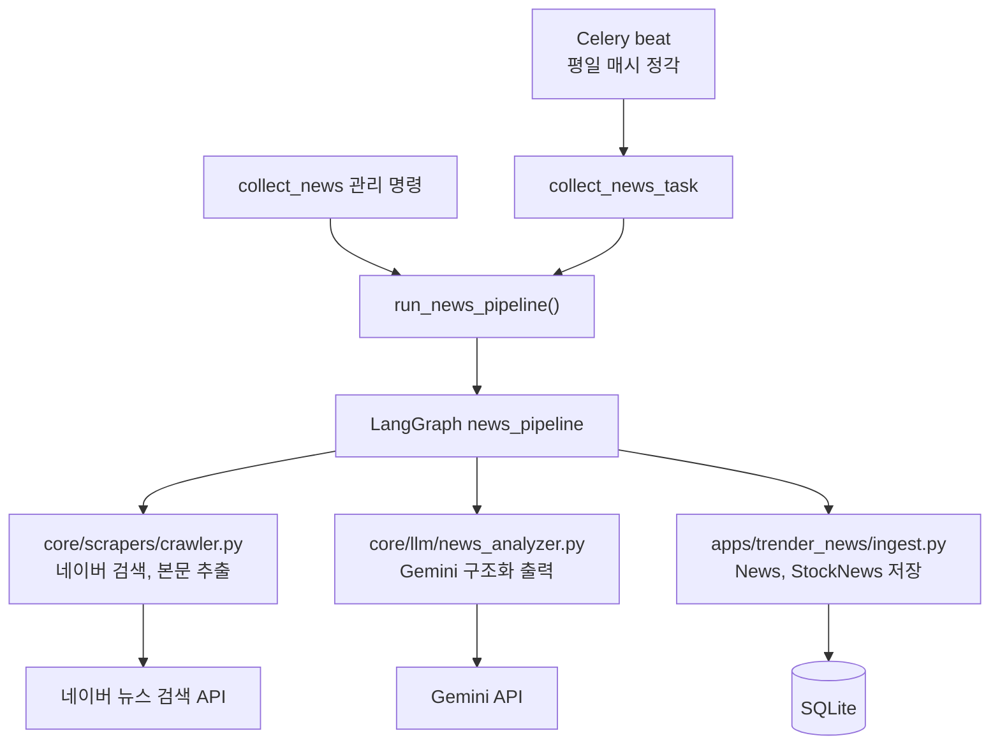
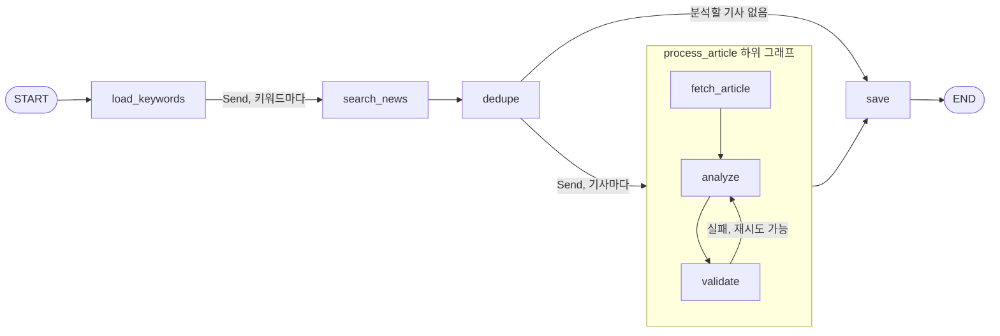
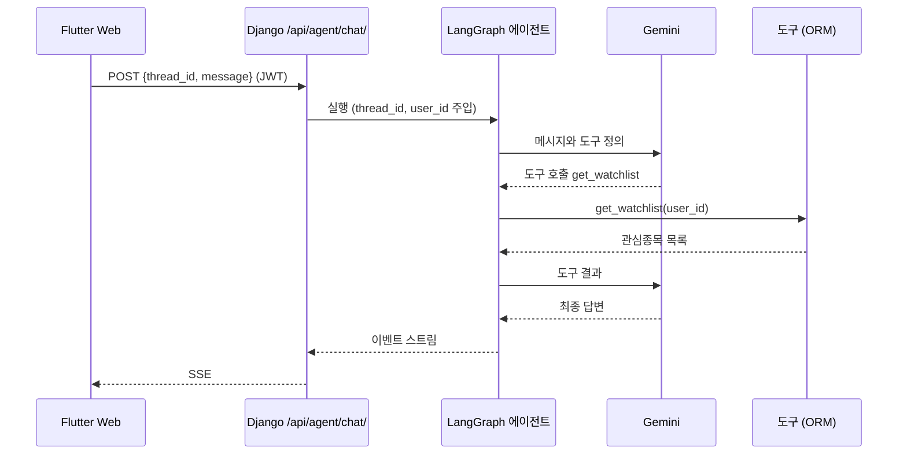

# LLM 파이프라인 설계

| 항목 | 내용 |
|---|---|
| 상태 | 뉴스 분석 파이프라인 구현 완료, 챗봇 에이전트 설계 단계 |
| 범위 | `backend/core/graph/`, `backend/core/llm/`, `backend/core/scrapers/` |
| 관련 문서 | [뉴스 분석 파이프라인 운영 가이드](../README/ai.md), [API 명세](api-spec.md) |

## 목차

- [배경](#배경)
- [목표와 비목표](#목표와-비목표)
- [전체 구성](#전체-구성)
- [뉴스 분석 파이프라인](#뉴스-분석-파이프라인)
- [검토한 대안](#검토한-대안)
- [변경 이력](#변경-이력)
- [향후 계획: 챗봇 에이전트](#향후-계획-챗봇-에이전트)
- [미결 사항](#미결-사항)

## 배경

초기 구현은 기능마다 LLM을 다르게 호출했습니다.

- 뉴스 라벨링은 Gemini를 직접 호출하는 스크립트(`teacher_model.py`)가 담당했고, 무료 등급 제한 때문에 기사당 4.2초씩 고정으로 대기했습니다.
- 서비스 경로는 파인튜닝한 Ollama 모델(`stock-llm`)을 호출하고 응답을 정규식으로 파싱했습니다.
- 수집, 분석, 저장이 한 명령 안에서 순차적으로 실행되어 기사 수에 비례해 시간이 늘었고, 부분 실패를 다루기 어려웠습니다.

이 문서는 이를 Gemini 단일 공급자와 LangGraph 워크플로우로 바꾼 현재 설계와, 이후 챗봇 에이전트의 설계 방향을 정리합니다.

## 목표와 비목표

### 목표

- LLM 공급자를 Gemini 하나로 통일하고, 응답은 정규식 대신 스키마 기반 구조화 출력으로 받습니다.
- 수집과 분석을 키워드 단위, 기사 단위로 병렬 실행하면서 외부 API 호출 한도를 지킵니다.
- 기사 하나의 실패가 전체 작업을 멈추지 않도록 하고, 실패 원인을 단계별로 기록합니다.
- 기존 REST API와 DB 스키마는 바꾸지 않습니다.

### 비목표

- 자체 모델 파인튜닝과 서빙. 관련 코드와 의존성은 제거했습니다.
- 여러 프로세스나 서버에 걸친 분산 실행. 분산과 스케줄링은 Celery가 담당합니다.
- 실시간 스트리밍 분석. 뉴스는 주기적으로 일괄 처리합니다.

## 전체 구성

| 계층 | 담당 |
|---|---|
| Celery | 언제 실행할지(스케줄), 어느 워커에서 실행할지(분산) |
| LangGraph | 한 번의 실행 안에서 단계 순서, 분기, 재시도, 병렬 실행 |
| 수집기, 분석기 | 외부 API 호출. 상태와 DB 접근이 없는 순수 함수 |
| ingest | DB 저장. 파이프라인의 저장 노드에서만 호출 |

## 뉴스 분석 파이프라인

### 그래프 구조

| 노드 | 입력 | 출력 | 비고 |
|---|---|---|---|
| `load_keywords` | `keywords` 또는 없음 | 대상 종목명 목록 | 기본값은 전체 사용자의 관심종목 |
| `search_news` | 키워드 1개 | `candidates` | 키워드마다 병렬 실행 |
| `dedupe` | 전체 `candidates` | `pending` | 이미 저장된 (종목, URL) 조합과 종목 마스터에 없는 키워드 제외 |
| `fetch_article` | 기사 1건 | 본문 | 50자 미만이면 실패 처리 |
| `analyze` | 기사와 본문 | `NewsAnalysis` | 본문은 8,000자까지 전달 |
| `validate` | 분석 결과 | `analyzed` 또는 `errors` | 최대 2회 시도 |
| `save` | 전체 `analyzed` | `stats` | 유일한 DB 쓰기 지점 |

### 상태

병렬 브랜치의 결과는 `operator.add` 리듀서로 누적합니다.

| 필드 | 리듀서 | 설명 |
|---|---|---|
| `keywords` | 덮어쓰기 | 대상 종목명 |
| `candidates` | 누적 | `search_news` 브랜치들의 검색 결과 |
| `pending` | 덮어쓰기 | 분석 대상 기사 |
| `analyzed` | 누적 | 검증을 통과한 기사와 분석 결과 |
| `errors` | 누적 | `{stage, keyword, url, error}` |
| `stats` | 덮어쓰기 | 저장 결과 통계 |

`process_article` 하위 그래프는 `output_schema`로 `analyzed`와 `errors`만 상위 그래프에 돌려줍니다. 기사 본문 같은 중간 데이터는 상위 상태에 남지 않습니다.

### 구조화 출력

분석기는 `ChatGoogleGenerativeAI.with_structured_output(NewsAnalysis)`로 JSON 스키마 기반 응답을 받습니다.

| 필드 | 타입 | 검증 |
|---|---|---|
| `summary` | `list[str]` | 비어 있지 않은 문장 |
| `sentiment` | `POSITIVE`, `NEGATIVE`, `NEUTRAL` | 열거형 |
| `reason` | `str` | 공백이 아닌 문자열 |
| `relevance` | `float` | 0.0 이상 1.0 이하 |

타입과 열거형은 Pydantic이 검증하고, 빈 요약, 빈 근거, 관련도 범위는 `validate` 노드가 `news_analyzer.validation_error()`로 검증합니다.

### 동시성과 호출 제한

| 제어 지점 | 설정 | 방식 |
|---|---|---|
| 그래프 전체 | `NEWS_PIPELINE_CONCURRENCY` (기본 4) | LangGraph 실행 설정의 `max_concurrency` |
| Gemini | `GEMINI_RPM` (기본 15) | 프로세스 단위 `InMemoryRateLimiter`. 429와 5xx는 최대 3회 재시도 |
| 네이버 본문 | `NAVER_FETCH_CONCURRENCY` (기본 2) | 세마포어와 0.6-1.2초 무작위 지연 |

브랜치 동시 실행 수와 외부 API 호출 속도를 따로 제어하므로, 동시성을 높여도 API 한도를 넘지 않습니다. 가짜 분석기(0.5초)로 기사 8건을 처리한 측정에서 `max_concurrency=1`은 4.0초, `max_concurrency=4`는 1.0초가 걸렸습니다.

### 저장과 멱등성

- 병렬 브랜치에서는 DB에 쓰지 않습니다. SQLite는 쓰기 잠금이 데이터베이스 단위여서 동시 쓰기가 실패할 수 있기 때문입니다.
- `dedupe`가 이미 저장된 (종목, URL) 조합을 제외하므로 같은 기사를 다시 분석하지 않습니다.
- 저장은 `update_or_create`를 사용하므로 같은 입력으로 다시 실행해도 중복 행이 생기지 않습니다.
- 실패한 기사는 저장되지 않으므로 다음 실행에서 자동으로 다시 시도됩니다.

### 보안

- 기사 본문은 외부 입력입니다. 시스템 프롬프트에서 본문 안의 지시문을 따르지 않도록 지정합니다.
- 분석 결과는 스키마와 열거형으로 제한되므로 모델 출력이 그대로 다른 동작을 일으키지 않습니다.
- API 키는 `backend/.env`에서만 읽으며, 키가 없으면 분석 단계에서 `ImproperlyConfigured`로 실패합니다.

## 검토한 대안

| 대안 | 장점 | 채택하지 않은 이유 |
|---|---|---|
| Celery 작업으로 기사마다 분산 (chord, group) | 여러 워커로 수평 확장 가능 | 단계 간 상태 전달과 재시도 흐름을 직접 구현해야 하고, 현재 처리량에는 과합니다. 필요해지면 키워드 단위로 Celery 분산을 추가할 수 있습니다 |
| 순차 실행 유지 | 구현이 단순 | 기사 수에 비례해 시간이 늘고, 실패 처리가 명령 전체에 묶입니다 |
| LLM이 도구 순서를 고르는 에이전트 | 유연함 | 뉴스 처리 순서는 고정되어 있어 LLM이 판단할 부분이 없습니다. 호출 비용과 비결정성만 늘어납니다 |
| 여러 에이전트의 병렬 협업 | 역할 분리 | 같은 작업을 데이터만 바꿔 반복하는 구조라 `Send` 기반 fan-out으로 충분합니다 |

정해진 순서의 작업은 고정 워크플로우로, 사용자의 열린 질문은 에이전트로 처리한다는 원칙에 따라 뉴스 분석은 `StateGraph`로 구현했습니다.

## 변경 이력

| 항목 | 이전 | 현재 |
|---|---|---|
| 분석 모델 | Gemini(라벨링), Ollama `stock-llm`(서빙) | Gemini (`GEMINI_MODEL`) |
| 응답 파싱 | 정규식 | Pydantic 구조화 출력 |
| 실행 구조 | 순차 실행, 기사당 4.2초 고정 대기 | LangGraph 병렬 실행, rate limiter |
| 관련도 | 1.0 고정 | 모델이 매긴 점수 저장 |
| 제거한 코드 | `teacher_model.py`, `ollama_client.py`, `test_models.py`, `json2jsonl.py`, 파인튜닝 노트북 | 해당 없음 |
| 유지한 코드 | `ai_verification.py` | 현재 분석기를 평가하도록 수정 |

## 향후 계획: 챗봇 에이전트

프론트엔드 챗봇 탭에 연결할 tool-calling 에이전트입니다. 아직 구현되지 않았습니다.

### 설계 원칙

- 에이전트는 기존 기능을 도구로 감싸서 호출합니다. 도구는 HTTP로 View를 다시 부르지 않고 같은 ORM과 Serializer 로직을 사용합니다. 공통 로직은 `apps/*/services.py`로 분리해 View와 도구가 함께 씁니다.
- 사용자 범위 데이터에 접근하는 도구는 LLM 입력으로 `user_id`를 받지 않습니다. 서버가 요청 사용자를 실행 설정(`config["configurable"]["user_id"]`)으로 주입해, 프롬프트 인젝션으로 다른 사용자 데이터에 접근하는 것을 막습니다.
- 데이터를 바꾸는 도구는 LangGraph `interrupt`로 실행을 멈추고 사용자 승인을 받은 뒤 실행합니다.
- 도구 결과에 포함된 뉴스 본문 등 외부 데이터 안의 지시문은 따르지 않도록 시스템 프롬프트에 명시합니다.

### 도구

| 도구 | 기존 기능 | 입력 | 승인 필요 |
|---|---|---|---|
| `search_stocks` | 종목 검색 | `query` | 아니오 |
| `get_stock_quotes` | 시세 조회 | `stock_ids` | 아니오 |
| `get_watchlist` | 관심종목 조회 | 없음 (요청 사용자) | 아니오 |
| `add_watchlist_item` | 관심종목 추가 | `stock_id`, `group_id` (선택) | 예 |
| `remove_watchlist_item` | 관심종목 제거 | `stock_id`, `group_id` | 예 |
| `get_stock_news` | 뉴스 조회 | `stock_id`, `sentiment` (선택), `limit` | 아니오 |

### 요청 흐름

쓰기 작업은 `interrupt`로 멈춘 뒤 SSE `confirm_required` 이벤트를 보내고, 사용자가 승인하면 `POST /api/agent/confirm/`으로 그래프를 재개합니다.

### API 초안

| 메서드 | 경로 | 설명 |
|---|---|---|
| `POST` | `/api/agent/chat/` | 질문 전송. SSE(`text/event-stream`)로 응답 |
| `GET` | `/api/agent/threads/` | 대화 스레드 목록 |
| `GET` | `/api/agent/threads/{thread_id}/` | 스레드 메시지 기록 |
| `DELETE` | `/api/agent/threads/{thread_id}/` | 스레드 삭제 |
| `POST` | `/api/agent/confirm/` | 쓰기 작업 승인과 그래프 재개 |

| SSE 이벤트 | 데이터 예시 | 설명 |
|---|---|---|
| `thread` | `{"thread_id": "..."}` | 새 스레드 생성 |
| `tool_start` | `{"tool": "get_stock_news", "input": {}}` | 도구 호출 시작 |
| `tool_end` | `{"tool": "get_stock_news"}` | 도구 호출 종료 |
| `token` | `{"text": "..."}` | 답변 텍스트 조각 |
| `confirm_required` | `{"action": "add_watchlist_item", "args": {}}` | 사용자 승인 필요 |
| `done` | `{}` | 응답 종료 |
| `error` | `{"detail": "..."}` | 오류 |

대화 상태는 LangGraph checkpointer에 스레드 단위로 저장합니다. 운영 환경에서는 PostgreSQL 전환과 함께 PostgreSQL checkpointer를 사용할 계획입니다.

## 미결 사항

- 뉴스 API의 `ai_reason`이 고정 문장을 반환합니다. `StockNews.reason`을 반환하도록 변경해야 합니다.
- `core/graph/news_pipeline.py`가 `apps`의 모델을 직접 참조합니다. `core`를 앱과 독립적으로 유지하려면 파이프라인을 `apps/trender_news`로 옮기거나 저장소 계층을 분리해야 합니다.
- rate limiter는 프로세스 단위입니다. Celery 워커를 여러 개 실행하면 전체 호출 속도가 워커 수만큼 늘어나므로, 그 경우 Redis 기반 공유 제한이 필요합니다.
- 실제 네이버, Gemini 키로 운영 데이터 처리량과 비용을 측정하지 않았습니다. 측정 후 `GEMINI_RPM`, `NEWS_PIPELINE_CONCURRENCY` 기본값과 모델 선택을 조정합니다.
- 분석 품질 평가에 사람이 검수한 라벨 데이터셋이 필요합니다.
